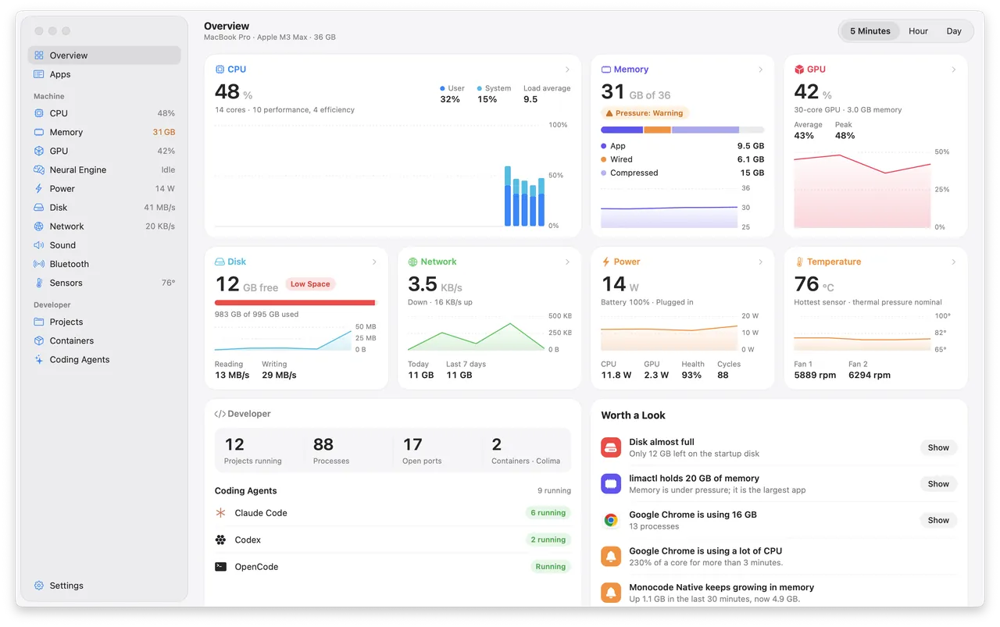
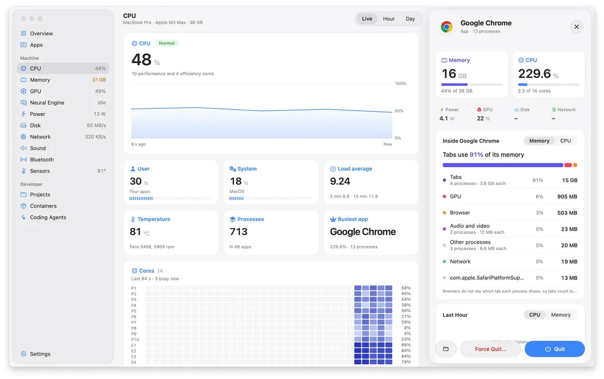

# Wisp

A system monitor for the Mac that tells you which app is using what, and costs
almost nothing to leave running.



Activity Monitor lists processes. Chrome alone is forty of them, so the
question "what is slowing my Mac down" turns into adding up rows. Wisp groups
every process under the app it belongs to and shows CPU, memory, GPU, power,
disk and network per app, with a day of minute-by-minute history and a year of
hourly totals.

It also knows about the things developers leave running: dev servers and the
ports they hold, Docker containers, and coding agents like Claude Code and
Codex.

## What it costs

Measured on 3 November 2026 on a MacBook Pro M3 Max running macOS 27.2, against
Vitals 1.9.7 over the same seconds, with each window 1300 by 800 points.
`scripts/perf-suite.py` runs these scenarios and writes the full table to
`build/perf/`.

| | Wisp CPU | Vitals CPU | Wisp memory | Vitals memory |
|---|---:|---:|---:|---:|
| Menu bar only | 0.42% | 0.83% | 19 MB | 238 MB |
| Overview window | 3.0% | 6.4% | 48 MB | 452 MB |
| CPU page | 3.3% | 5.4% | 57 MB | 245 MB |
| Memory page | 3.0% | 4.7% | 63 MB | 245 MB |
| Disk page | 2.9% | 5.4% | 63 MB | 254 MB |

CPU is the mean over 90 one-second samples, as a share of one core. Vitals also
woke the CPU 50 to 85 times a second while idle; Wisp, under 5.

Wisp redraws its menu bar every 3 seconds by default, and stops sampling the
things no open view shows. [docs/performance.md](docs/performance.md) covers
how, what didn't work, and how to measure it yourself.

## The window

Pages for CPU, memory, GPU, Neural Engine, power, disk, network, sound,
Bluetooth and sensors, each with a live, hourly or daily chart and the apps
behind the numbers. The GPU page shows each app's share of GPU time, read from
the graphics driver.

Click any app and a drawer slides in with everything about it: memory, CPU,
power, GPU, disk and network, what is inside it (for a browser that is tabs,
the GPU process, extensions and the network service), the last hour, its
command line, and Quit or Force Quit.



The Projects page finds every project folder with something running in it,
lists its servers and ports, and flags servers nobody has connected to for 30
minutes. Containers talks to the Docker socket directly, so it works with
Docker Desktop, OrbStack, Colima, Rancher Desktop and Lima. Coding Agents shows
each running agent, the folder it works in and what it costs the machine.

## The menu bar

Pick any mix of CPU, memory, network, disk, GPU, temperature, power and
battery, as numbers or small graphs. Clicking it opens a dashboard you can
rearrange in Settings.

## Alerts

Wisp sends a notification when an app holds a core for minutes, grows by a
gigabyte in half an hour, keeps writing to disk or the network, or goes over a
limit you set for it, and when the Mac runs hot.

## Install

There is no signed download yet. Apple charges 99 USD a year for the
certificate that lets an app open without a warning, so for now you build it
yourself. It takes about a minute.

You need macOS 15 or later on Apple silicon, and Xcode 16 or later. Wisp looks
its best on macOS 26, which adds the Liquid Glass sidebar and toolbar.

```sh
git clone https://github.com/current/wisp
cd wisp
scripts/build-app.sh
open build/Wisp.app
```

## Command line

The app bundle includes a `wisp` command:

```sh
ln -s "$PWD/build/Wisp.app/Contents/Helpers/wisp" /usr/local/bin/wisp
```

```
wisp status            the machine now and the five busiest apps
wisp apps --sort memory
wisp app Safari        one app, its processes and the last hour
wisp ports             dev servers by project
wisp agents
wisp docker
wisp alerts
```

Add `--json` for output you can pipe into `jq`. While the app runs, `wisp`
asks it over a local socket and answers in a few milliseconds. Without the app
it takes its own one-second sample.

## Asking an assistant

`wisp mcp` is an MCP server, so Claude Code or another assistant can ask what
is slowing the machine down:

```sh
claude mcp add wisp -- /usr/local/bin/wisp mcp
```

It reads the same figures as the CLI. The one thing it can do is ask to quit
an app. Wisp then shows you the app, what it uses and the reason the assistant
gave, and quits it only if you click Quit. It cannot kill processes or change
settings. Turn it off in Settings under Assistants.

## Privacy

Wisp reads everything on your Mac and sends nothing anywhere. History stays in
`~/Library/Application Support/Wisp`. There is no updater and no analytics.

One feature talks to the network, and it is off until you turn it on: plan
limits on the Coding Agents page. Wisp then reads the sign-in Claude Code keeps
in your Keychain (with the `security` tool, as Claude Code does) and the one
Codex keeps in `~/.codex/auth.json`. It sends each one only to the company that
issued it, every five minutes while the page is open, and never stores,
refreshes or logs them.

## License

MIT, see [LICENSE](LICENSE). The IOReport channel names for CPU power on recent
Macs come from [macmon](https://github.com/vladkens/macmon), also MIT; see
[NOTICE](NOTICE).
