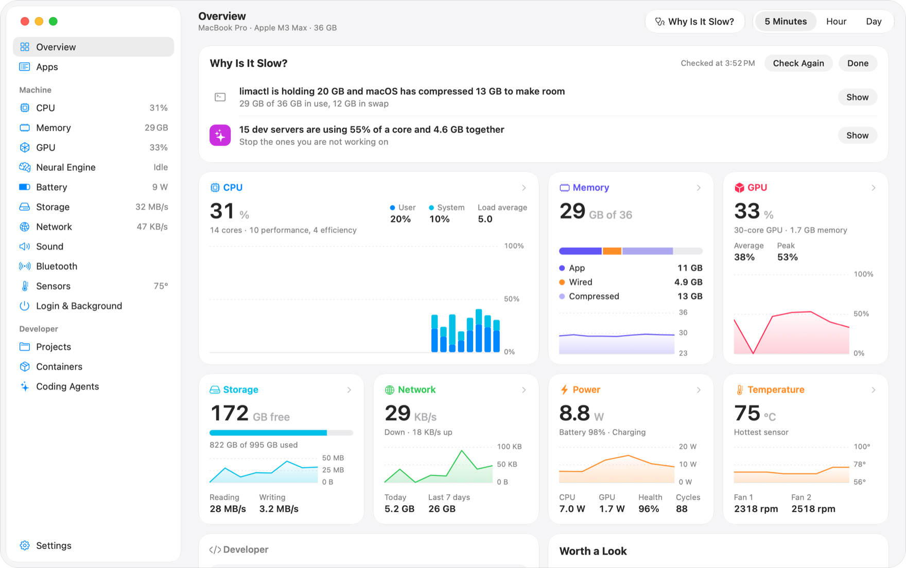
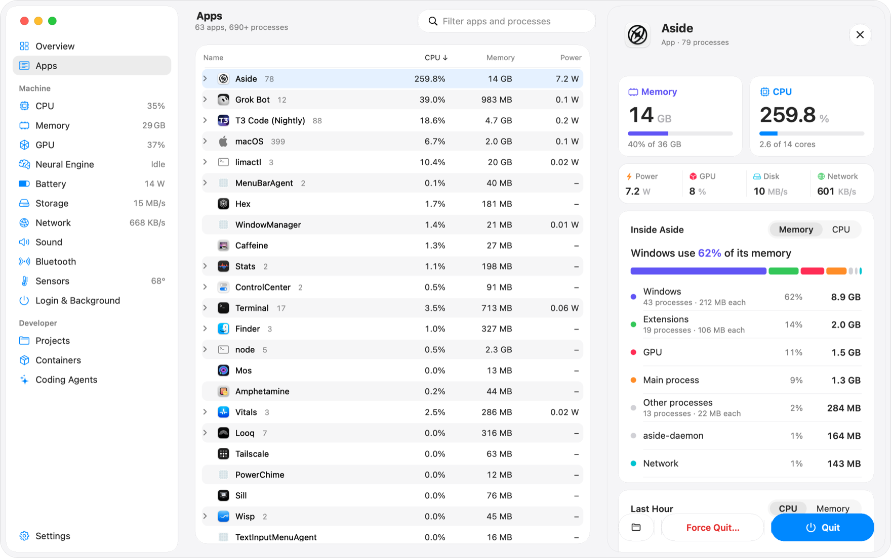
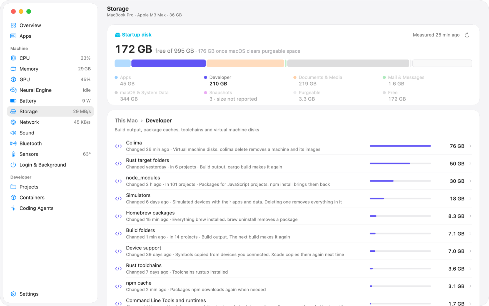
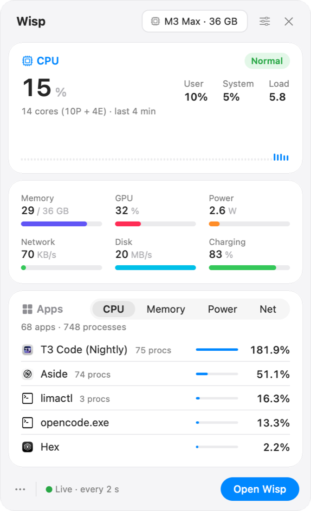

# Wisp

Wisp is a system monitor for macOS that groups processes by app. Chrome's forty
processes are one row, with its CPU, memory, GPU, power, disk and network use,
and you can open that row to see which windows, extensions and helpers the
numbers come from.

[wisp-mac.com](https://wisp-mac.com) · [Download](https://github.com/current/wisp/releases/latest) · [Changelog](CHANGELOG.md) · [Performance](docs/performance.md)

<picture>
  <source media="(prefers-color-scheme: dark)" srcset="docs/images/overview-dark.png">
  
</picture>

## Why is my Mac slow?

The Why Is It Slow? button on Overview checks memory pressure, swap, CPU use per
app, Spotlight indexing and the dev servers you left running, then lists what it
found with a button to the app. In the screenshot above, a Lima VM was using
20 GB. `wisp why` runs the same check in a terminal.

The Hour and Day charts label each spike with the app that caused it.

## Apps

Click an app to open the drawer. It splits the app's memory and CPU between its
windows, extensions, GPU process and helpers. It also lists the hosts the app is
connected to, the data it used this month, its disk use including caches and
containers, and its last hour.

<picture>
  <source media="(prefers-color-scheme: dark)" srcset="docs/images/apps-dark.png">
  
</picture>

## Storage

The Storage page splits the disk into apps, developer folders, documents and
System Data. Developer folders include node_modules, DerivedData, Rust target
folders, simulators and VM disks. You can move items from the list to the Trash
after a confirmation. Wisp does not delete files itself.

<picture>
  <source media="(prefers-color-scheme: dark)" srcset="docs/images/storage-dark.png">
  
</picture>

## Other pages

- Battery: health, charge history and the apps that used the most energy.
  Desktop Macs get a Power page instead.
- Login & Background: launch agents, daemons and helpers, with who made each one
  and what it costs. Leftovers from deleted apps are flagged.
- Projects: dev servers and their ports by project. Servers idle for 30 minutes
  are marked.
- Containers: Docker Desktop, OrbStack, Colima, Rancher Desktop and Lima.
- Coding Agents: Claude Code, Codex and others, the folder each one works in,
  and what it costs the Mac.
- CPU, memory, GPU, Neural Engine, network, sound, Bluetooth and sensors, each
  with the apps behind the numbers.

Wisp keeps a day of history by the minute and a year by the hour in
`~/Library/Application Support/Wisp`. It has no analytics, updater or account.

The menu bar item opens a dashboard you can rearrange in Settings.

<picture>
  <source media="(prefers-color-scheme: dark)" srcset="docs/images/dashboard-dark.png">
  
</picture>

## Performance

Measured on 3 November 2026 on a MacBook Pro M3 Max with macOS 27.2, Wisp and
Vitals 1.9.7 over the same 90 seconds. CPU is the mean of 90 one-second samples,
as a share of one core.

| Scenario        | Wisp CPU | Vitals CPU | Wisp memory | Vitals memory |
|-----------------|---------:|-----------:|------------:|--------------:|
| Menu bar only   |    0.42% |      0.83% |       19 MB |        238 MB |
| Overview window |    3.03% |      6.41% |       48 MB |        452 MB |
| CPU page        |    3.32% |      5.40% |       57 MB |        245 MB |
| Memory page     |    3.00% |      4.69% |       63 MB |        245 MB |
| Disk page       |    2.89% |      5.42% |       63 MB |        254 MB |

While idle, Vitals woke the CPU 50 to 85 times a second and Wisp under 5 times.
`scripts/perf-suite.py` runs these scenarios. [docs/performance.md](docs/performance.md)
has the method and what Wisp does to stay at these numbers.

## Install

Download `Wisp-0.2.0.zip` from the
[latest release](https://github.com/current/wisp/releases/latest), unzip it and
drag Wisp to Applications. It needs macOS 15 or later on Apple silicon and looks
best on macOS 26.

The build is not notarized, so macOS stops the first launch. Open System
Settings > Privacy & Security and click Open Anyway, or run:

```sh
xattr -dr com.apple.quarantine /Applications/Wisp.app
```

To build it yourself with Xcode 16 or later:

```sh
git clone https://github.com/current/wisp && cd wisp
scripts/build-app.sh && open build/Wisp.app
```

### Command line

The app includes a `wisp` command:

```sh
ln -s /Applications/Wisp.app/Contents/Helpers/wisp /usr/local/bin/wisp
```

```sh
wisp status              # the machine now and the five busiest apps
wisp apps --sort memory
wisp app Safari          # one app, its processes and the last hour
wisp why                 # what is slowing the Mac down right now
wisp storage             # disk space by kind and what can go
wisp ports               # dev servers by project
wisp agents
wisp docker
```

Add `--json` to pipe the output into `jq`.

### MCP server

`wisp mcp` is an MCP server, so Claude Code or another assistant can ask what is
slowing the machine down:

```sh
claude mcp add wisp -- /usr/local/bin/wisp mcp
```

It can also ask to quit an app. Wisp shows you the app and the reason, and quits
it only if you click Quit.

### Plan limits

Plan limits on the Coding Agents page are off until you turn them on. Wisp reads
the figures Claude Code and Codex already write on your Mac. It never reads
their sign-in or sends the figures anywhere.

Claude Code passes its 5-hour and weekly limits to its status line. Turning plan
limits on adds `wisp statusline` to the status line command in each Claude Code
settings file. If you already had a status line, Wisp runs it after saving the
limits. It looks the same as before. Turning plan limits off puts the old
command back. A copy of each settings file is kept in
`~/Library/Application Support/Wisp/claude-settings-backup`. Claude Code only
reports limits on Pro, Max and Ultra plans.

Codex writes its limits to its session logs in `~/.codex/sessions`, and Wisp
reads the latest entry.

The figures are as recent as your last reply in each tool.

## License

MIT. CPU power channel names come from [macmon](https://github.com/vladkens/macmon)
(see [NOTICE](NOTICE)).
