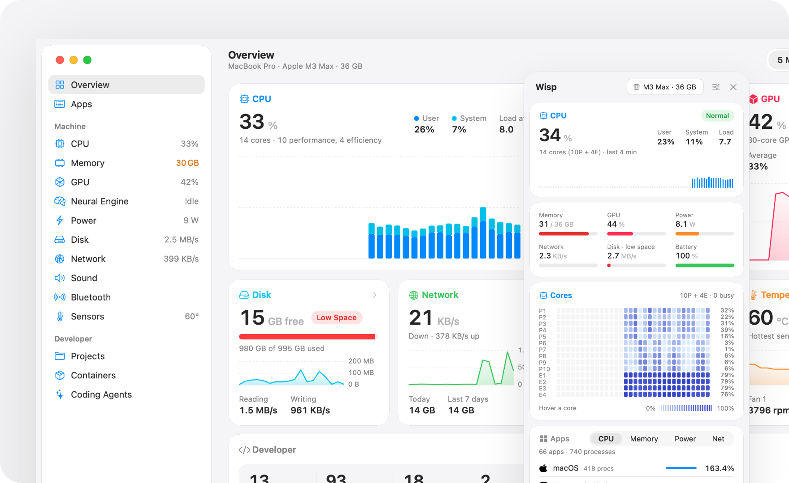
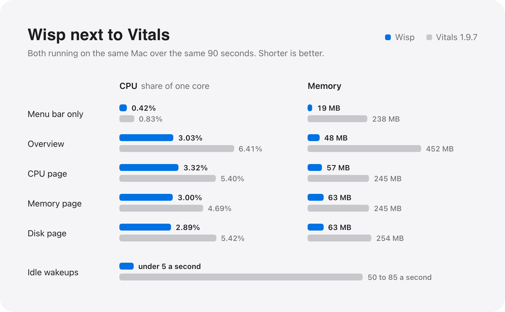
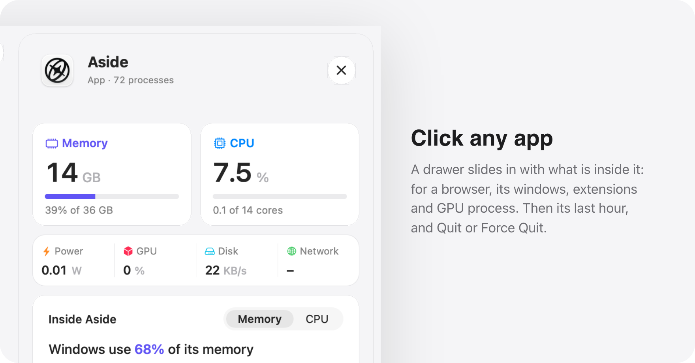
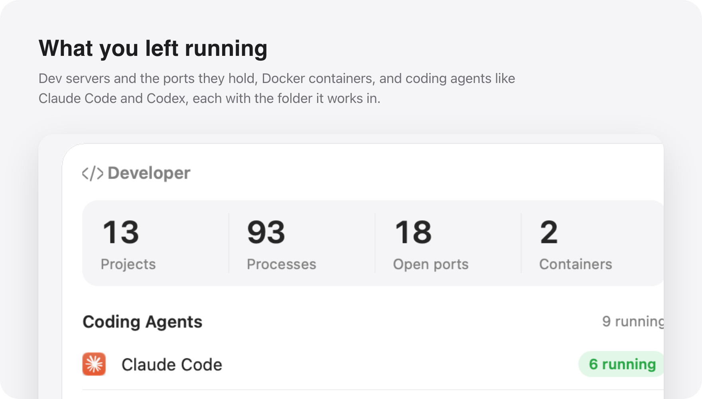
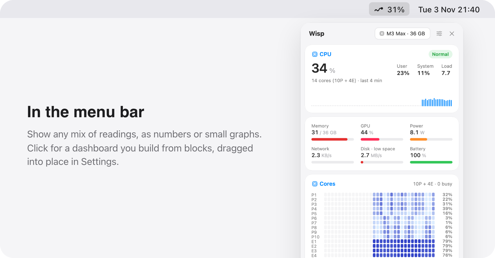

<p align="center">
  
</p>

<h1 align="center">Wisp</h1>

<p align="center">See which app is using your Mac, from a monitor that barely uses it.</p>

<p align="center">
  <a href="https://wisp-mac-gamma.vercel.app">Website</a>
  &nbsp;&middot;&nbsp;
  <a href="#install">Install</a>
  &nbsp;&middot;&nbsp;
  <a href="docs/performance.md">Performance</a>
</p>

<p>
<picture>
  <source media="(prefers-color-scheme: dark)" srcset="docs/images/hero-dark.png">
  
</picture>
</p>

<br>

Activity Monitor lists processes, and Chrome alone is forty of them. Wisp adds
them up under the app they belong to and shows CPU, memory, GPU, power, disk and
network per app, with a day of history by the minute and a year by the hour. It
also keeps an eye on what developers leave running: dev servers and their ports,
Docker containers, and coding agents like Claude Code and Codex.

## What it costs

<p>
<picture>
  <source media="(prefers-color-scheme: dark)" srcset="docs/images/compare-dark.png">
  
</picture>
</p>

<table>
  <thead>
    <tr>
      <th align="left" rowspan="2">Scenario</th>
      <th colspan="2">CPU, share of one core</th>
      <th colspan="2">Memory</th>
    </tr>
    <tr>
      <th align="right">Wisp</th>
      <th align="right">Vitals</th>
      <th align="right">Wisp</th>
      <th align="right">Vitals</th>
    </tr>
  </thead>
  <tbody>
    <tr><td>Menu bar only</td><td align="right"><b>0.42%</b></td><td align="right">0.83%</td><td align="right"><b>19 MB</b></td><td align="right">238 MB</td></tr>
    <tr><td>Overview window</td><td align="right"><b>3.03%</b></td><td align="right">6.41%</td><td align="right"><b>48 MB</b></td><td align="right">452 MB</td></tr>
    <tr><td>CPU page</td><td align="right"><b>3.32%</b></td><td align="right">5.40%</td><td align="right"><b>57 MB</b></td><td align="right">245 MB</td></tr>
    <tr><td>Memory page</td><td align="right"><b>3.00%</b></td><td align="right">4.69%</td><td align="right"><b>63 MB</b></td><td align="right">245 MB</td></tr>
    <tr><td>Disk page</td><td align="right"><b>2.89%</b></td><td align="right">5.42%</td><td align="right"><b>63 MB</b></td><td align="right">254 MB</td></tr>
  </tbody>
</table>

While idle, Vitals woke the CPU 50 to 85 times a second; Wisp, under 5.

<sub>Measured on 3 November 2026 on a MacBook Pro M3 Max with macOS 27.2 and
Vitals 1.9.7, both apps over the same 90 seconds. CPU is the mean of 90
one-second samples. <code>scripts/perf-suite.py</code> runs these scenarios;
<a href="docs/performance.md">docs/performance.md</a> explains how Wisp stays
this light and how to measure it yourself.</sub>

## What it does

<p>
<picture>
  <source media="(prefers-color-scheme: dark)" srcset="docs/images/drawer-dark.png">
  
</picture>
</p>

<p>
<picture>
  <source media="(prefers-color-scheme: dark)" srcset="docs/images/dev-dark.png">
  
</picture>
</p>

<p>
<picture>
  <source media="(prefers-color-scheme: dark)" srcset="docs/images/menubar-dark.png">
  
</picture>
</p>

<br>

- CPU, memory, GPU, Neural Engine, power, disk, network, sound, Bluetooth and
  sensors, each with live, hourly and daily charts and the apps behind the
  numbers. GPU time per app comes from the driver.
- Every project with something running, its servers and ports, and servers idle
  for 30 minutes. Containers from Docker Desktop, OrbStack, Colima, Rancher
  Desktop and Lima.
- Alerts when an app holds a core for minutes, grows by a gigabyte in half an
  hour, keeps writing, or passes a limit you set.
- No analytics, no updater, no account. History stays in
  `~/Library/Application Support/Wisp`.

## Install

There is no signed download yet, so you build it yourself. It takes about a
minute. You need macOS 15 or later on Apple silicon and Xcode 16 or later. Wisp
looks its best on macOS 26.

```sh
git clone https://github.com/current/wisp && cd wisp
scripts/build-app.sh && open build/Wisp.app
```

<details>
<summary><b>Command line</b></summary>
<br>

The app bundle includes a `wisp` command:

```sh
ln -s "$PWD/build/Wisp.app/Contents/Helpers/wisp" /usr/local/bin/wisp
```

```sh
wisp status              # the machine now and the five busiest apps
wisp apps --sort memory
wisp app Safari          # one app, its processes and the last hour
wisp ports               # dev servers by project
wisp agents
wisp docker
```

Add `--json` for output you can pipe into `jq`.

</details>

<details>
<summary><b>For coding agents</b></summary>
<br>

`wisp mcp` is an MCP server, so Claude Code or another assistant can ask what is
slowing the machine down:

```sh
claude mcp add wisp -- /usr/local/bin/wisp mcp
```

The one thing it can do is ask to quit an app. Wisp shows you the app and the
reason, and quits it only if you click Quit.

</details>

<details>
<summary><b>Plan limits and privacy</b></summary>
<br>

Plan limits on the Coding Agents page are off until you turn them on. Wisp then
reads the sign-in Claude Code keeps in your Keychain and the one Codex keeps in
`~/.codex/auth.json`. It sends each only to the company that issued it, every
five minutes while the page is open, and never stores, refreshes or logs them.

</details>

<br>

<p align="center"><sub>MIT License &nbsp;&middot;&nbsp; CPU power channel names from <a href="https://github.com/vladkens/macmon">macmon</a>, see <a href="NOTICE">NOTICE</a></sub></p>
